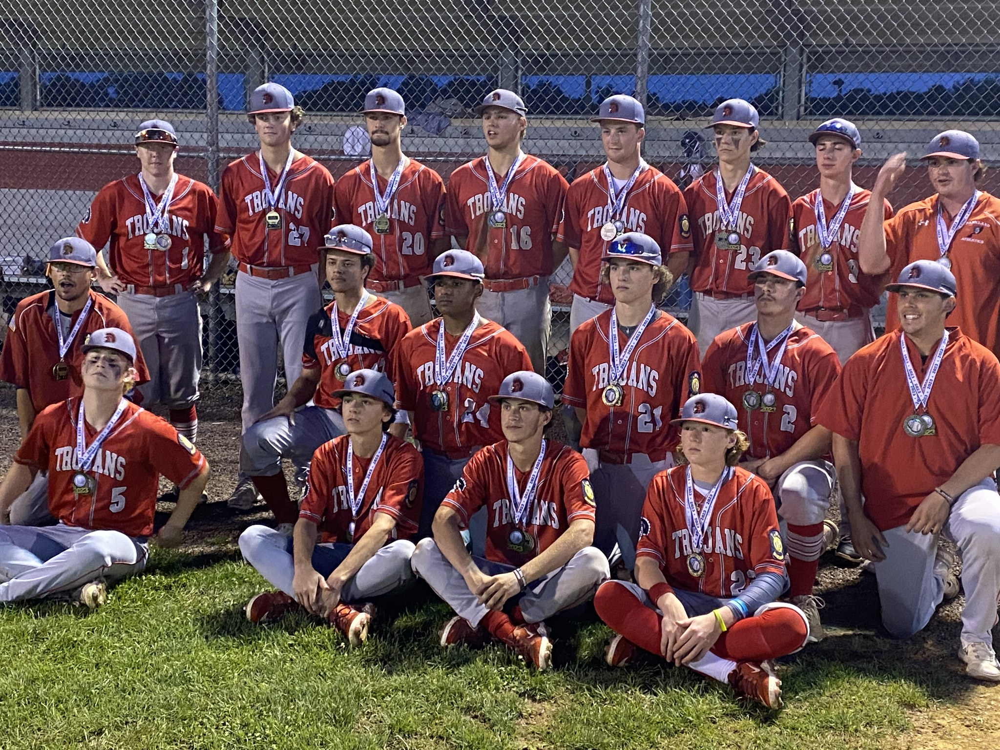

<div align="center">


# South Parkland Youth Association
### A place to play. A team to belong to.

**A modern, responsive website redesign for SPYA, a volunteer-powered youth sports association serving the Allentown, Pennsylvania community.**

[**Explore the live redesign**](https://atalwar0312.github.io/spya-redesign/) · [Official SPYA website](https://spya.org/) · [View the code](https://github.com/atalwar0312/spya-redesign)

</div>

---

## Overview

The **SPYA Website Redesign** is a community-focused front-end project built to make youth sports information easier to discover and navigate. It gives families a clear starting point for sports programs, registration, financial assistance, association contacts, and community activities.

Rather than requiring visitors to hunt through multiple pages, the redesign prioritizes three simple questions:

1. **What can my child play?** Find SPYA's nine sports and explore each program.
2. **How do we get started?** Find registration resources and links to the relevant TeamSnap forms.
3. **How can we participate?** Learn about financial assistance, volunteering, leadership, and community events.

The result is a lightweight website with a stronger visual identity, accessible interactions, and layouts designed for both mobile and desktop visitors.

> **Project status:** This repository is an independent website redesign/prototype. It is **not** the official SPYA website. For authoritative announcements, registration availability, eligibility, and program policies, refer to [spya.org](https://spya.org/) and the linked registration provider.

## Website preview

<div align="center">
  
  <p><sub>Real SPYA team photography used in the redesign.</sub></p>
</div>

**[Visit the redesigned website](https://atalwar0312.github.io/spya-redesign/)**

## Highlights

| Area | What it offers |
| --- | --- |
| **Modern homepage** | Large typography, athlete photography, a clear mission statement, prominent next steps, and featured association announcements. |
| **Nine sports** | A searchable sports directory with individual program pages and contact information. |
| **Registration hub** | Seasonal registration information and links to TeamSnap, with reminders to confirm actual form availability. |
| **Family resources** | Financial assistance policy and application, volunteer information, common questions, and association documents. |
| **Community** | Championship highlights, event/calendar access, and links to SPYA social channels. |
| **About & leadership** | Association mission, location, executive-board contacts, and links to current official information. |
| **Motion & interaction** | Subtle entrance animations, scroll reveals, hover feedback, and an accessible mobile navigation menu. |
| **Responsive design** | Fluid layouts for smaller phones, tablets, laptops, and larger screens. |

### Sports at SPYA

The sports directory includes:

| | | |
| --- | --- | --- |
| Baseball | Basketball | Cheer |
| Field Hockey | Football | Lacrosse |
| NFL Flag | Soccer | Softball |

Every sports page should be treated as a guide, not as a guarantee that registration is currently open. Program dates and arrangements can change between seasons.

## Design philosophy

The visual direction is **confident, welcoming, and community-centered**.

- **Athletes first:** Authentic youth-sports photography and strong headlines give the site a human focus.
- **Clear paths:** Visitors can reach Sports, Registration, Families, Community, and About through a consistent main navigation.
- **SPYA identity:** The existing association logo and a restrained red, dark-green, and neutral palette anchor the design.
- **Purposeful motion:** Transitions should make navigation feel polished without distracting users from essential information.
- **Simple, readable controls:** Buttons and text links communicate their destination without unnecessary decorative arrows.
- **Accessibility-conscious choices:** Semantic markup, a skip-to-content link, keyboard focus styles, descriptive image text, and reduced-motion behavior.

### Accessibility and performance considerations

The implementation includes accessibility-minded features, but **it has not been certified against a particular WCAG conformance level**.

- Navigation uses semantic links and `aria-current` on the active page.
- The mobile menu exposes its expanded state using `aria-expanded`, and supports Escape to close.
- The sports search reports the visible result count.
- Scroll effects use `IntersectionObserver` when available and avoid running for users who prefer reduced motion.
- Images use responsive sizing and lazy loading where appropriate.
- The website uses plain HTML, CSS, and JavaScript without a required application framework.

## Technology stack

| Technology | Role |
| --- | --- |
| **HTML5** | Page structure, content, navigation, and semantic markup |
| **CSS3** | Responsive layouts, typography, visual identity, hover states, and animations |
| **Vanilla JavaScript** | Mobile navigation, sports filtering, announcement expiry, and scroll reveals |
| **Git & GitHub** | Source control and collaborative review |
| **GitHub Pages** | Static-site publishing |
| **TeamSnap** | External registration forms linked from the website |

No package installation, bundler, or JavaScript framework is required to view the static pages locally.

## Repository guide

The repository keeps all public HTML pages at the root so GitHub Pages links continue to work. Supporting assets, code, structured content, and development guidance are grouped into their own folders.

| Document | Purpose |
| --- | --- |
| [Project structure](docs/PROJECT_STRUCTURE.md) | Directory map, file ownership, and important generator safety warning |
| [Maintenance & QA](docs/MAINTENANCE.md) | Editing workflow, release checklist, and troubleshooting |
| [Contributing](CONTRIBUTING.md) | Code and content standards, branches, and review process |
| [Pull request template](.github/PULL_REQUEST_TEMPLATE.md) | Consistent change descriptions and testing notes |

**Important:** The root HTML pages are the current source of truth. The old `scripts/build_site.py` generator predates the latest redesign and is intentionally disabled by default to prevent accidental overwrites.

Run the non-destructive structural check before requesting review:

```bash
python3 scripts/check_structure.py
```

## Project structure

```text
spya-redesign/
├── index.html             # Homepage
├── sports.html            # Searchable sports directory
├── registration.html      # Registration resources and links
├── resources.html         # Families, assistance, volunteering, FAQs
├── community.html         # Championships and community highlights
├── about.html             # Mission and leadership
├── calendar.html          # Association calendar
├── baseball.html          # Individual sports pages
├── basketball.html
├── cheer.html
├── field-hockey.html
├── football.html
├── lacrosse.html
├── nfl-flag.html
├── soccer.html
├── softball.html
├── assets/
│   └── images/            # Logo, team photos, and graphics
├── css/
│   └── styles.css         # Layout, styles, responsive rules, animation
├── js/
│   └── app.js             # Interactive website behavior
├── data/                  # Content/source materials
├── docs/                  # Project notes and reviews
└── scripts/               # Repository utilities and validation tools
```

The HTML pages are deliberately kept at the repository root so their relative links remain compatible with the GitHub Pages project URL.

## Getting started

### Option A: View online

Open the **[live demo](https://atalwar0312.github.io/spya-redesign/)**. No installation is required.

### Option B: Run locally

1. Clone the repository:

   ```bash
   git clone https://github.com/atalwar0312/spya-redesign.git
   cd spya-redesign
   ```

2. Open `index.html` in a browser, or start a simple local server:

   ```bash
   python3 -m http.server 8000
   ```

3. If using the local server, visit **http://localhost:8000**.

A local server is recommended when inspecting navigation and assets across pages.

## Deployment

This is a **static GitHub Pages project**. The live demo is available at:

**https://atalwar0312.github.io/spya-redesign/**

To publish from the repository, confirm that GitHub Pages is configured to serve the intended branch and root folder under **Settings > Pages**. Changes to a development branch do not automatically become live; they need to be merged into the publishing branch if Pages is configured to publish from that branch.

### Updating the site

1. Create a working branch from `main`.
2. Edit content and styles, preserving internal links and responsive behavior.
3. Test desktop and mobile navigation, registration links, keyboard focus, and reduced-motion behavior.
4. Open a pull request for review.
5. Merge once the changes have been approved and checked.
6. Verify the deployed GitHub Pages site after publishing.

**Cache note:** The HTML files include a version query on the stylesheet URL (for example, `css/styles.css?v=...`). When changing shared styles, update that version consistently across pages if visitors might otherwise see cached CSS.

## Content maintenance

Youth sports details are time-sensitive. The site should be reviewed at the start of each season and whenever SPYA publishes an announcement.

| Content | Maintenance check |
| --- | --- |
| Registration | Verify TeamSnap form URLs, dates, and whether the forms still accept registrations. |
| Sports pages | Confirm divisions, seasons, commissioner contacts, and equipment information. |
| Leadership | Compare names and email contacts with SPYA's official board page. |
| Financial assistance | Confirm that the policy and application link to the newest published versions. |
| Featured announcements | Remove or replace expired dates, events, and promotions. |
| Photos | Confirm appropriate permission and attribution for published team imagery. |
| Navigation & layout | Test links, responsive views, and active navigation states after edits. |

**Source of truth:** [Official SPYA website](https://spya.org/). The redesign is an informational prototype and should not be treated as a replacement for official program communications.

## Contribution and review

Feedback is welcome, especially around clarity for families, accessibility, mobile usability, visual consistency, and information accuracy.

For a proposed improvement:

1. Open an issue describing the desired change, or create a branch.
2. Keep changes focused and use clear commits.
3. Submit a pull request with an explanation and a testing summary.
4. Validate information sourced from SPYA before publishing it.

For consistency, updates to this project may use short pull request titles such as **Update 1**, **Update 2**, and so on. Put detailed explanations inside the pull request description rather than in the title.

## Project goals

- Make it easy for a parent to find the right program.
- Reduce friction between discovering a sport and finding registration information.
- Represent SPYA's community, volunteers, and achievements with care.
- Provide an appealing prototype that can be reviewed by stakeholders and board members.
- Keep the website maintainable without adding unnecessary technical complexity.

## Credits and acknowledgments

- **South Parkland Youth Association:** The community, sports programs, association identity, and information that inspired the redesign.
- **SPYA athletes, coaches, families, and volunteers:** The people at the heart of the website's story.
- **Website redesign:** Developed and maintained in this repository by [atalwar0312](https://github.com/atalwar0312).

SPYA's logo, photographs, and other association assets belong to their respective owners. Their presence in this prototype does not imply an endorsement or transfer of rights. External links such as TeamSnap and the official SPYA website are operated independently.

---

<div align="center">

### More than a game. A place to belong.

Made with care for the South Parkland youth sports community.

**[Live website](https://atalwar0312.github.io/spya-redesign/)** · **[Official SPYA](https://spya.org/)**

</div>
